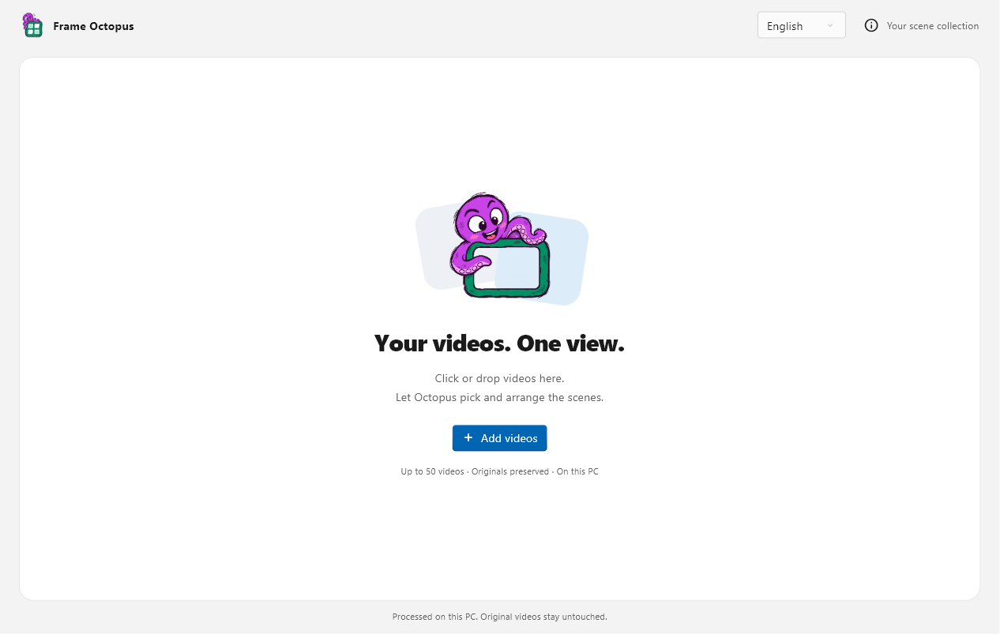
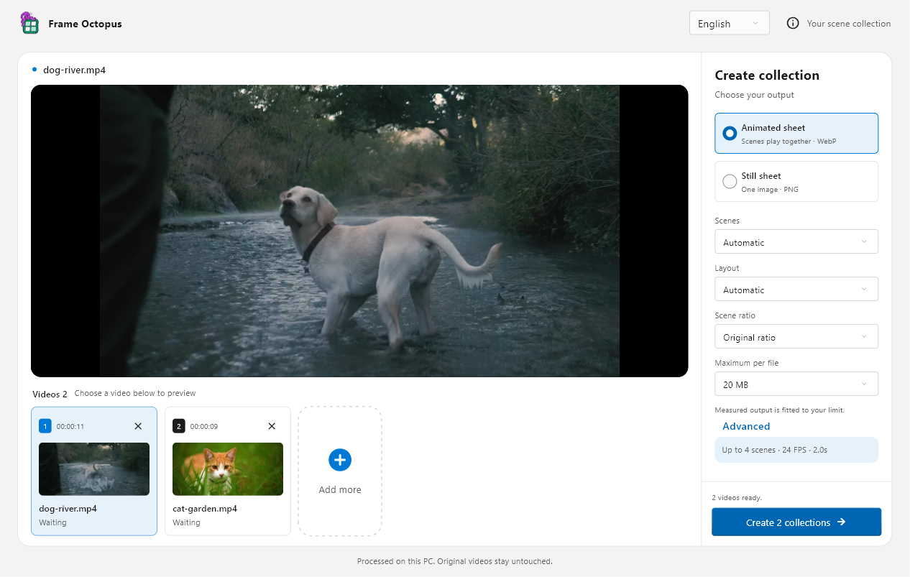
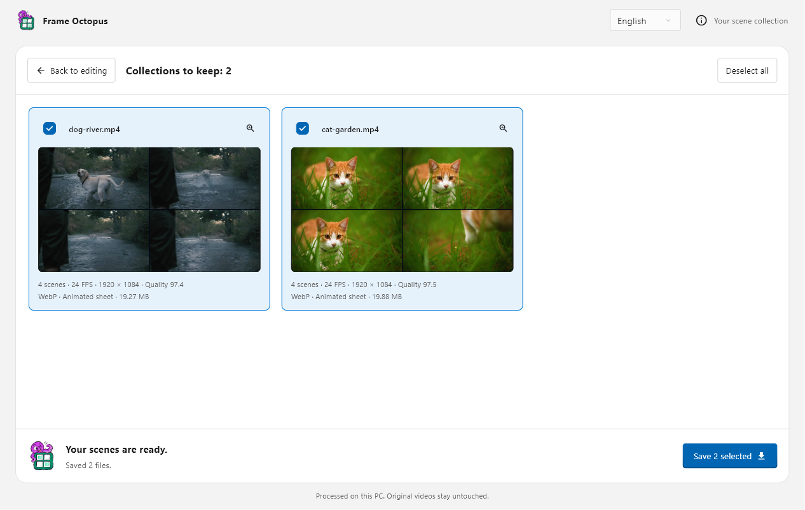

# Frame Octopus

An offline Windows video contact-sheet studio built with Flutter and Fluent UI. Add videos, choose a still or animated sheet and save only the results you want. The default language is **English**; Korean and Japanese can be selected and are remembered.

## Features

- Full-surface click or Windows drag-and-drop upload; up to 50 videos.
- Horizontal video filmstrip, original playback, inline queue removal and a pinned create button.
- Still PNG and looping animated WebP collections.
- Automatic or 4/8/12/24 maximum scenes. Short sources reduce the actual count automatically.
- Automatic, wide or tall arrangement; original, square, 16:9 or 9:16 scene ratio. Choosing a different scene ratio applies a centered crop.
- Flexible last rows fill the available width. Row height adapts to preserve the chosen scene ratio instead of leaving an unused grid cell.
- Per-file size limits: 1/5/10/20/50/100 MB, or no limit. The default is 20 MB. MB means 1,000,000 bytes.
- Quality-first measured fitting uses representative compression samples before encoding the complete animation. It starts at a 1920-pixel canvas with a WebP quality ceiling of 100, preserves scene coverage and clip duration first, and caps FPS at the source rate. WebP extracts/composes once, then samples at most 12 frames across the beginning, middle and end of the prepared animation. One Q90 sample estimates size and selects resolution before a full encode. Clearly spare capacity allows Q95 without another sample; spare bytes are otherwise deliberately left unused. No exhaustive quality search is performed. The first key frame is accounted for once, and static output is not incorrectly multiplied by the frame count. Geometry changes reuse the merged source. A normal result needs one full encode; actual overflow triggers at most two corrections and scene fallback remains a last resort. PNG keeps lossless encoding and searches for the highest fitting even width. Oversized candidates are discarded; scene count is reduced only when the requested coverage cannot fit.
- Animation clip length defaults to Automatic: usable scene count is determined first, then video duration / usable scenes is capped at 10 seconds. A 10-second video uses four 2.5-second clips; a 12-second video uses four 3-second clips. Very short sources use their available duration. Long videos remain representative samples when the cap is reached. Advanced allows disabling automatic length and choosing 0.5–10 seconds manually; the manual value and mode are remembered. FPS also defaults to Automatic: read the source nominal frame rate, cap at 30 FPS and limit each clip to approximately 120 frames. For example a 60 FPS source uses 30 FPS for a 2-second clip and 12 FPS for a 10-second clip. Low-rate sources are not raised beyond their nominal rate. Advanced can disable automatic FPS and request 4–30 FPS; the manual value is remembered and still capped by the source. Capacity fitting may lower FPS further if necessary. These controls are disabled for still sheets.
- Actual output size, scene count, resolution, FPS and WebP quality are shown with completed results. Results support zoom preview, selection and collision-safe folder export. Successful export displays a five-second success notification with the saved file count and destination folder; the result status remains visible afterward.
- Preferences and language persist. Closing the window is prevented during active work; stop first.
- Fluent UI controls, a neutral gray/white background, Windows blue accent, and the original octopus mascot.

The size estimate is content-dependent and approximate, not an exhaustive perceptual optimum. Reported quality scores use relative canvas width, FPS and encoder quality weights of 0.8, 0.6 and 0.35. Final acceptance always uses actual file bytes. Tight limits can still require multiple real encodes; Stop remains available. A larger limit allows higher quality but does not force padding the file to that size.

Animated sheets play representative clips simultaneously. They are not a full-timeline export and have no audio. Layout, size and smoothness can change during capacity fitting. The size limit applies separately to each generated file, not to a batch total. Completed results are stored locally until exported; source videos are never overwritten.

## Run and build

Install Flutter with Windows desktop support and Visual Studio's Desktop development with C++ workload:

```powershell
flutter pub get
flutter run -d windows
flutter build windows --release
```

The installed development toolchain is Flutter 3.41.9 / Dart 3.11.5. `fluent_ui` is pinned to 4.13.0 for compatibility; newer versions were not compatible with this SDK in compilation checks. Do not update the dependency without running the focused checks.

Distribute the **entire** `build/windows/x64/runner/Release` directory, including DLLs, data and licenses. The executable alone is insufficient. Native libraries download during build; media conversion runs locally.

## Interface

The app keeps a simple add → create → save flow, with its own layout. Videos appear beneath the preview; output settings live on the right, and the primary action remains visible while settings scroll. Interaction research referenced https://wooingbee.ink/oder/dcinside; no website code or artwork from that service is bundled.







## Verification

```powershell
flutter analyze
flutter test
.\tool\verify_windows.ps1 -VideoPath C:\path\to\short-video.mp4
.\tool\verify_quality.ps1 # Compare the same source at 1 MB and 20 MB
.\tool\verify_batch.ps1 -VideoPaths @('C:\path\a.mp4', 'C:\path\b.mp4')
```

Native verification uses the real Windows FFmpeg/player pipeline, a 1 MB output limit, decoded image frames and duplicate-name export. It records render-tree screenshots and English/Japanese views under the Git-ignored verification directory. See docs/TESTING.md for measured results and limits. The current 1 MB / 20 MB speed/quality comparison and actual output examples are retained in distribution-media/fast-optimization/. Earlier baselines remain in distribution-media/speed-comparison/ and distribution-media/quality-comparison/.

## Origin and port

Original Mosaic: https://github.com/mosaicvideo/mosaic

Flutter Android port and source of the processing engine and octopus assets: https://github.com/idlepoe/mosaic

This separate project adapts sampling, layout, FFmpeg and image composition logic for Windows. Native file/folder dialogs replace Android gallery integration. Capacity fitting, flexible rows, the desktop workflow and Fluent interface are implemented here. The original Mosaic project is not modified.

## Development stages

1. Windows foundation and real generation — implemented.
2. Desktop upload, preview, file cards and selected-result export — implemented.
3. Simple scene/layout choices and flexible last rows — implemented.
4. Measured capacity optimization — implemented and checked against a 1 MB limit.
5. Preferences, English/Korean/Japanese, zoom preview and job/error handling — implemented; focused checks passed.
6. Development MSIX and release documents — prepared. Final Store identity, public policy URL, complete native redistribution review and Store certification/submission remain release gates. No Store publication is claimed.

## Packaging and privacy

See packaging/README.md and packaging/STORE_LISTING.md. The development MSIX is unsigned and uses a provisional identity; it is not an install-ready signed release. Microsoft signs accepted Store MSIX packages, so a separate paid signing certificate is not required for that path.

Privacy policy: docs/PRIVACY.md. Licensing: LICENSE and THIRD_PARTY_NOTICES.md. Retain the complete native license directory and finalize corresponding-source/relinking distribution materials before public release.

## Release media

Current native PNG screenshots, Store-framed 1920x1080 versions, a 1080p app demo and generated collections are in `distribution-media/`. See [distribution-media/README.md](distribution-media/README.md) for source credits, license selection and reproduction. The raw sample footage remains local and is excluded from application packages and Git.
